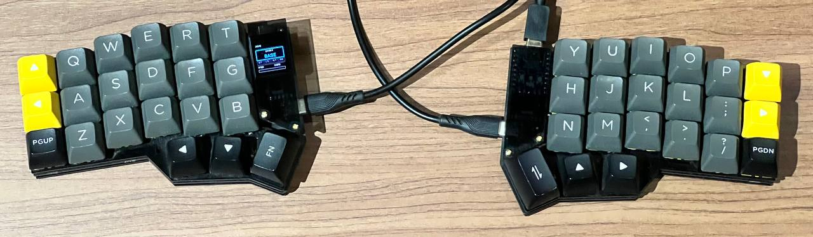
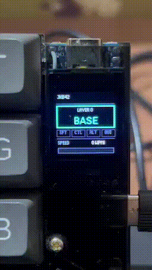

# Mili's KB — JKB42 (Corne 42-Key Split)

<p align="center">
  
</p>

<p align="center">
  <strong>A high-performance QMK firmware for the JKB42 (Corne 42-key split keyboard) powered by dual Raspberry Pi RP2040 microcontrollers, an ST7735 1.44" color TFT SPI display with a custom Quantum Painter Cockpit HUD, and an ergonomically optimized Miryoku layout with zero-lag Home Row Mods.</strong>
</p>

<p align="center">
  
  
  
  
</p>

---

## 📺 Live Display: The Quantum Painter Cockpit HUD

The keyboard features a 128×128 pixel ST7735 color TFT display driven via SPI using QMK's native **Quantum Painter** graphics engine.

Unlike heavy GIF animations that consume excessive SPI bandwidth and cause dropped keystrokes, this custom UI uses lightweight vector primitives and font caching. Firmware size is **under 150 KB** with **sub-millisecond draw latency** and zero keyboard lag.

<p align="center">
  
</p>

### Display Architecture (Option B Cockpit Strip)

```text
+-----------------------------------+
| Mili's KB                  [CAPS] |  <-- Top Header & Smart Lock Badge
|-----------------------------------|  <-- Separator Line (y: 24)
|   +---------------------------+   |
|   |          LAYER 4          |   |  <-- Dynamic Layer Card (y: 28..72)
|   |            NAV            |   |      (Color-coded per layer)
|   +---------------------------+   |
|  [ SFT ]  [ CTL ]  [ ALT ]  [ GUI]|  <-- Live Modifier Pills (y: 76..90)
|-----------------------------------|  <-- Separator Line (y: 94)
| SPEED                     85 WPM  |  <-- Live WPM readout (y: 98)
| [============               ]     |  <-- Color-graded progress bar (y: 113..123)
+-----------------------------------+
```

### HUD Features

1. **Customizable Header Title**:
   - Shows **`Mili's KB`** (configurable via `#define DISPLAY_HEADER_TEXT` in `config.h`).
2. **Smart Lock & Word Badge**:
   - **Full Caps Lock**: Glowing **Red** `[CAPS]` badge.
   - **Caps Word Active**: Glowing **Amber** `[WORD]` badge.
   - **Idle**: Clean black background.
3. **Dynamic Layer Card**:
   - Distinct colored borders and titles corresponding to each active Miryoku layer:
     - **BASE**: Yellow
     - **EXTRA**: Light Blue
     - **TAP**: Pure White
     - **BUTTON**: Teal
     - **NAV**: Electric Purple
     - **MOUSE**: Magenta
     - **MEDIA**: Crimson Red
     - **NUM**: Cyan
     - **SYM**: Bright Green
     - **FUN**: Tangerine Orange
4. **Live Modifier Pills (`[ SFT ]  [ CTL ]  [ ALT ]  [ GUI ]`)**:
   - **Inactive**: Stealth dark frame with dim text.
   - **Active**: Glowing solid pill with high-contrast text:
     - `[ SFT ]` $\rightarrow$ Amber Gold
     - `[ CTL ]` $\rightarrow$ Cyan
     - `[ ALT ]` $\rightarrow$ Purple
     - `[ GUI ]` $\rightarrow$ Neon Green
5. **Speedometer & WPM Gauge**:
   - Instant WPM counter throttled to 100ms updates to prevent bus contention.
   - Color-graded progress bar: Green (<30 WPM) $\rightarrow$ Yellow (<60 WPM) $\rightarrow$ Orange (<90 WPM) $\rightarrow$ Red (100+ WPM).

---

## ⚡ Miryoku Layout & Zero-Lag Home Row Mods

This firmware runs the popular 36-key **Miryoku** layout mapped across the 42 physical keys (3x6_3) of the Corne/JKB42 footprint.

### Zero-Lag Home Row Mod Optimization

Standard Home Row Mods often suffer from a noticeable pause or "stutter" during fast typing because the firmware buffers dual-role keys to decide between a tap and a hold.

This build solves the dual-role dilemma using modern QMK algorithms:

* **`CHORDAL_HOLD` (Opposite-Hands Rule)**:
  - Left Alphas (Rows 0, 1, 2) are mapped to `'L'`.
  - Right Alphas (Rows 4, 5, 6) are mapped to `'R'`.
  - Thumb clusters (Rows 3 & 7) are set to `'*'` (exempt).
  - **Result**: When rolling keys quickly on the same hand (e.g. typing `fr`, `st`, `wa`), QMK knows it is impossible to be a modifier chord and settles the letter **instantly with 0 ms delay**.
* **`PERMISSIVE_HOLD`**:
  - Legitimate cross-hand modifier chords (e.g. holding `F` for Shift and tapping `J`) trigger immediately without waiting for the full 200 ms timeout.
* **`FLOW_TAP_TERM 150`**:
  - When typing in a continuous flow (keystrokes closer than 150 ms apart), QMK automatically outputs letters at 0 ms latency without entering the hold evaluation queue.

### Caps Lock & Caps Word Superpowers

| Action | Result | Screen Indicator |
| :--- | :--- | :--- |
| **Tap `CW_TOGG` once** (Nav layer, key next to `L`) | **Caps Word** (auto-capitalizes until next space/symbol) | Amber `[WORD]` |
| **Double-tap `CW_TOGG`** | **Full Caps Lock** | Red `[CAPS]` |
| **Hold `Shift` + Tap `CW_TOGG`** | **Full Caps Lock** | Red `[CAPS]` |

---

## 🛠️ Hardware Specifications

| Component | Specification |
| :--- | :--- |
| **Keyboard** | JKB42 (Corne 3x6_3 Split Ortholinear, 42 keys) |
| **Microcontrollers** | Dual Raspberry Pi RP2040 (Zero / Pico based) |
| **Inter-half Link** | Full-duplex USART Serial (`GP0` TX, `GP1` RX) with EE_HANDS |
| **Split Sync** | Synced Layers (`SPLIT_LAYER_STATE_ENABLE`), WPM, Modifiers, LED state |
| **Display** | 1.44" ST7735 TFT Color LCD (128×128, SPI) |
| **SPI Configuration** | SPID1 (`SCK: GP10`, `MOSI: GP11`, `DC: GP12`, `RST: GP13`, `CS: GP9`, `BLK: GP14`) |
| **Lighting** | 42× WS2812 RGB Matrix (Per-key + Underglow) |

---

## 🚀 Flashing Instructions

Pre-compiled firmware binaries are automatically built by GitHub Actions and available under [Releases](../../releases).

1. **Enter Bootloader Mode**:
   - Hold **Right Space** (Thumb) and double-tap **`Q`** (`TD(U_TD_BOOT)`).
   - *Alternatively*: Double-tap the physical reset button on the controller board.
2. The keyboard will mount as an external USB mass storage drive named **`RPI-RP2`**.
3. Drag and drop **`jadookb_jkb42_miryoku_split_3x6_3_ex2.uf2`** onto the drive.
4. The controller will automatically flash and reboot in seconds.

---

## 💻 Building from Source

### Using QMK CLI (Local)

1. Ensure you have QMK installed:
   ```bash
   python3 -m pip install --user qmk
   qmk setup
   ```
2. Enable this userspace repository:
   ```bash
   qmk config user.overlay_dir="$(realpath .)"
   ```
3. Compile the firmware:
   ```bash
   qmk compile -kb jadookb/jkb42 -km miryoku_split_3x6_3_ex2
   ```

### Using GitHub Actions (Cloud CI)

This repository includes [`.github/workflows/build_binaries.yaml`](.github/workflows/build_binaries.yaml). Every time you push changes to GitHub, GitHub Actions will compile the firmware in the cloud and automatically create a release with the compiled `.uf2` file attached.

---

## ⚙️ Customization

- **Change Display Title**: Edit `DISPLAY_HEADER_TEXT` in [`keyboards/jadookb/jkb42/config.h`](keyboards/jadookb/jkb42/config.h):
  ```c
  #define DISPLAY_HEADER_TEXT "My Keyboard"
  ```
- **Adjust Flow Tap Term**: In `keyboards/jadookb/jkb42/config.h`:
  ```c
  #define FLOW_TAP_TERM 150  // Adjust between 120-180ms depending on typing speed
  ```
- **Change Layer Colors**: Edit `layer_info[]` in [`keyboards/jadookb/jkb42/jkb42.c`](keyboards/jadookb/jkb42/jkb42.c) using HSV values.

---

## 📜 License

This project is licensed under the **GPL v2.0 or later**, matching upstream QMK Firmware.
Layout architecture based on [Miryoku](https://github.com/manna-harbour/miryoku) by Manna Harbour.
